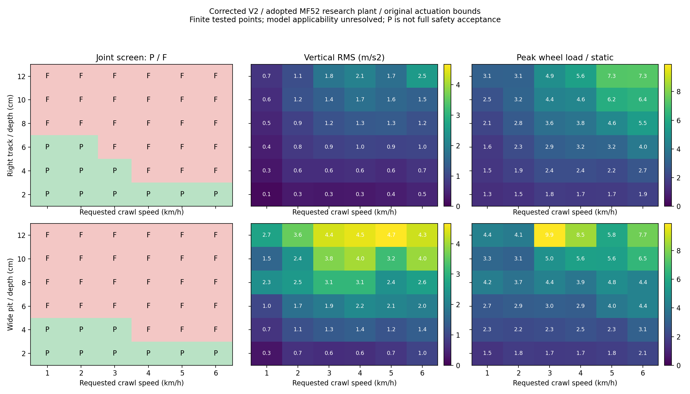

# 专家二深坑优先验证、行程核查与接触协调（2026-10-25）

本轮继续使用已知坑形预瞄前馈＋经典反馈。先验证8/10/12 cm深坑，再覆盖两类坑的1–6 km/h。保留用户采纳的MF52研究基线和专家一软件能力，不采纳更快电机或未标定轮胎替代。**尚未实现10 cm深坑、1–6 km/h全域可靠通过，不能进入以这些工况为合格样本的大规模采集。**

## 已确认的深度边界

10 cm不能直接作为“悬架够不到”的切换深度。当前模型的静态Jnc约为FL 38、FR 23、RL 43、RR 33 mm，研究回弹界限−149 mm；最弱角的轮端静态下伸余量约171.8 mm，扣除显式20 mm研究余量约151.8 mm。这个计算假定车身姿态、轮胎压缩保持不变，既不是执行器实体有效行程，也不是15 cm可安全过坑的证明。

新增独立MF52静止实验，四角先做±400 N小幅有界脉冲，再以400 N/s慢增共同伸展力。实际输入连续限速1000 N/s，小于45400 N/s基线；保留1 MPa制动仅用于静态保持。到研究行程余量触发后卸载，**仿真继续完整运行45 s**。最大力约3437 N，最小Jnc约−128.6 mm；没有测到物理硬限。弹性止挡也不是不可穿透的几何约束。

原车前悬架局部弹簧位移/Jnc比例约0.782，后悬架约0.956，说明轮端行程不能直接当作执行器行程。实验只支持模型几何核查，缺少执行器安装几何、实测规格以及真实底盘最低点，仍不能给出实车额定行程或不会触底的结论。

|坑深|固定车身条件下最弱角剩余Jnc余量|再扣20 mm研究余量|
|---|---:|---:|
|8 cm|约91.8 mm|约71.8 mm|
|10 cm|约71.8 mm|约51.8 mm|
|12 cm|约51.8 mm|约31.8 mm|

上述是静态可达估计。车身侧倾1°在半轮距处约改变11 mm相对高度，俯仰1°在约0.96 m杠杆处约改变17 mm；轮胎载荷变化也会改变压缩。动态边界必须同时考虑轮载、行程、接触、车身运动、转矩响应和坑沿形状，不能只按深度分一条线。

当前10 cm失败病例常见Jnc最低约−67～−88 mm，距离−149 mm仍有明显余量；主要先失败的是轮载和轮速/接触，而非伸展行程耗尽。因此暂不把10 cm以上自动交给专家一；专家一也仅能在其已有单侧坑验证范围内候选接管，宽深坑没有已验证的抬轮接管策略。

实验与校验：[行程证据](../evidence/shallow_extension_20261025/verified_analysis.json)、[静止实验图](../evidence/shallow_extension_20261025/stationary_extension.png)。运行入口为`python scripts/probe_shallow_extension.py --run-id <唯一编号>`；该入口始终标记诊断，不输出策略通过。

## 接触问题与控制修正

原2 ms轮速环把“用于纠偏的目标横摆角速度”代入实际轮迹速度。这会在转弯/纠偏时虚构轮速差。现已改为实测横摆角速度，纠偏仍由外环转矩分配和转向负责；增加自由滚动转弯的物理一致性回归。接地/失载切换时同时清除轮速差微分记忆，避免把切换前的微分带入新接触状态。

同参数、同坑形和名义能力的10 cm宽坑、1 km/h匹配对照：轮速代理误差峰值约11.54→0.74 m/s，车身垂向RMS约2.138→1.550 m/s²，轮载峰值/静载约6.36→3.31。**仍未通过**轮速、接触保持、轮载和倒溜筛查。单侧10 cm、1 km/h轮速峰值反而由2.38升到2.76 m/s，不能称为所有指标统一改善。最终逐项数值及重复/步长验证以本报告关联的机器校验表为准。

该10 cm宽坑的默认0.5 ms结果重复完全一致，但0.25 ms步长下轮速误差约4.73 m/s、垂向RMS约1.985 m/s²；80 ms车身时延下误差约9.42 m/s、实际均速约0.733 km/h。**默认步长下的改善尚未显示数值收敛与时延鲁棒性**，不作为深坑能力承诺。修正前后实际均速约1.089与1.121 km/h，属于相同目标速度的闭环整体比较，也不是严格锁定相同轨迹速度的单独悬架效果辨识。

原有轮速代理量会混入轮心相对车身的纵向运动，以及爬坑沿时的垂向几何运动。例如原V2宽坑4 cm、3 km/h的最差点，代理误差约0.345 m/s，而离线径向切平面近似约0.166 m/s；两者不能互换后直接放行。宽坑6 cm、3 km/h最差点则是车身向前约0.706 m/s、车轮周向反向约−3.224 m/s，原生Kappa约−5.45，轮迹近似修正后仍约−3.90 m/s，确有反转/严重滑移现象，不能全部归因于代理指标。

在该6 cm事件前后2 s窗口，实际电机转矩约95%的时间处在1000 Nm/s变化率边界。轮胎接触力矩能在约20 ms变化200–300 Nm，但基线电机同期最多改变20 Nm；把PD目标频繁切到±500 Nm无法让实际转矩同步实现。这个时序冲突与接触模型、悬架引起的轮载突变共同作用，并非已证实的单一根因。原生接触力矩与Fx、受载半径、滚阻的符号关系吻合，没有找到导出符号反转的证据。

新增只读诊断入口，可对已完成且有完整来源的运行导出最差轮速事件、轮心运动近似、原生Kappa、实际转矩/接触力矩、轮载和悬架力，不修改验收：

```powershell
python scripts/analyze_shallow_contact.py --run runs/shallow_press/wide/<工况编号> --output evidence/<新的事件目录>
```

见[事件索引数据](../evidence/shallow_deep_coordination_20261025/contact_events/wide06v3/event.json)和[事件曲线](../evidence/shallow_deep_coordination_20261025/contact_events/wide06v3/event.png)。轮心速度采用离线中心差分，径向法线仅为接触切平面近似，未作为新控制真值或替代旧门槛。

## 未采纳的对照

所有对照保留原生完整历史和源码快照；没有把不同配置的通过点拼接成同一控制器的能力。

|对照|完成项数|研究联合通过|结论|
|---|---:|---:|---|
|原V2，8/10/12 cm，两类坑，1/3 km/h|12|0|行程可达不等于动态可通过|
|去掉轮速差微分D|4|0|10 cm宽坑明显恶化，D不是唯一根因|
|轮心/径向切平面近似进入轮速环|8|2|仅4 cm、3 km/h两类坑通过，未解决深坑，不采纳该控制量测路径|
|groundhook改用2 ms新鲜轮端反馈|5|0|深坑轮载/滑移仍失败，未作为活动接口保留|
|弹簧/阻尼实际力反应式补偿＋运动比|5|0|高速宽坑可放大俯仰和轮载，不采纳|
|以实际转矩为状态的一阶转矩率反馈|6|0|没有解决深坑，且4 cm锚点退化，不采纳|

失败分支已移至[可校验归档](../archive/preview_development_20261025/README.md)，不进入活动控制参数。活动控制器保留最小物理一致性修正、原预瞄前馈与反馈结构、原V2参数与原能力基线。轮心工具只保留作诊断。对照详情分别见`evidence/shallow_deep_coordination_20261025/`各子目录的`case_index.md`及`verified_analysis.json`。

## 轮胎模型适用性与授权结论

本机安装的TNO《MF-Tyre/MF-Swift 6.2 User Manual》24–29页区分了平滑单点接触与短障碍包络接触。当前3114是平滑单点＋线性瞬态模式；手册对短坑洞/台阶建议2D或3D接触。本工况坑沿过渡仅5 cm，不能据当前模式结果标定真实深坑能力。Siemens官方同样说明MF-Swift增加3D障碍包络能力及轮胎带束层动力学，见[官方产品说明](https://www.siemens.com/en-us/products/simcenter/mechanical-simulation/tire-simulation/)及[包络原理说明](https://blogs.sw.siemens.com/simcenter/simcenter-tire-driver-in-the-loop/)。安装版本的具体开关、授权与步长规则仍以本机6.2手册为准。

尝试独立3544模式时，原生轮胎初始化报告FLEXnet连接`26000@localhost`被拒绝（−15,10 / WinSock10061），尚未开始积分。用户确认没有或暂不清楚授权，因此MF-Swift路线记为授权不可用，不继续试启动授权服务，不更改研究基线。该次是初始化失败，不能计作已完成仿真或物理失败。见[初始化记录](../evidence/shallow_model_applicability_20261025/initialization_status.json)。

不需要MF-Swift的3124非线性瞬态单点模式可以运行，但仍未解决坑洞包络问题。10 cm宽坑、3 km/h的20 s独立诊断，在10 µs步长下轮速峰值约2.75 m/s、RMS约3.35 m/s²、轮载比约3.98，仍失败；100 µs步长下分别约9.40、3.80、4.62，存在明显步长敏感性。该20 s诊断不替代40 s完整任务验证，也不能单凭尾部尚未停车推断卡死。其身份固定为未采纳模型诊断，`simulation_pass=false`、`acceptance_pass=false`。

另一个3124可用性检查沿用旧`--probe`阶跃符号探针，只用于确认模式能初始化，不作为变化率对齐、行程或控制性能证据。该旧探针直接施加阶跃，不能与新的连续限速45 s行程实验混用。

**接触模式适用性存在问题，不等于已经证明所有失败都来自轮胎模型。**测量定义、接触瞬态、转矩变化率、前馈近似及悬架力协调都需要分别验证。后续应先用独立的、不依赖MF-Swift授权的短障碍接触对照核验准静态力/力矩、低速滚动、重接地和步长收敛，再决定是否作为研究基线；不能直接换模型获得PASS，也不能只拉长物理坑沿来回避原问题。

## 当前控制流程和约束

静止沉降→平滑调平→限加速度起步；按各轮位置与已知坑形预瞄支撑高度。在该轮进坑前，预瞄下降的高度/速度通过弹簧、阻尼和轮端惯性近似生成伸展附加力；后轮按自己的位置触发。途中叠加升沉、侧倾、俯仰与轮端运动反馈，出坑沿参考上升后改变力以抑制上冲。总驱动由车速PI与不足车速时的爬沿补偿生成，按左右平衡和可用轮载分配；2 ms轮速环抑制滑移，重接地渐进恢复驱动，转向反馈维持直行；后轴完整驶出后停车保持。

悬架工作力6000 N，硬限±18200 N、45400 N/s；转矩±500 Nm、1000 Nm/s。悬架参考速度0.25 m/s、参考加速度1.5 m/s²仅为整形假设，不是硬件规格。提高工作力、反馈频率或增益都可能增加轮载峰值；反应式补偿试验已经体现这种代价，需要受变化率约束的预瞄力协调。没有把用户批准的更快电机扫描采纳为能力基线。

筛查保持原阈值：姿态5°、横移5 cm、Jnc范围−149～155 mm、带载轮速代理误差0.35 m/s、10 ms冲击15 m/s²、最大轮载/静载2.5等。失载时长、接触占比、后轴通过、停车、倒溜、出坑停顿、实际均速和九路输入限幅/限速都独立检查。垂向RMS作为性能量列出，不能仅据RMS降低宣称联合通过。控制器8°异常分支可以降速并记录失败，但不截断原生仿真，实际速度另列。

## 当前仍存在的问题

72项主矩阵均完成前后轮驶出及停车，输入幅值/变化率均通过；52项仍未满足过程联合筛查。“未通过”不等于车辆最终没有驶出。主要问题如下，同一工况可同时计入多项：

|问题|主矩阵不通过项数|现象及开发含义|
|---|---:|---|
|带载轮速差/滑移|52|4 cm较高速度及更深坑明显；部分深坑存在反转，不能全部按坑沿几何误差解释。继续约束实际转矩响应和接触切换，而非只增大PD目标。|
|轮载峰值|47|超过静载2.5倍。加大下压力、反馈频率或取消被动力都可能进一步放大轮载，需要预瞄力整形和四角协调。|
|接触保持|33|失载持续或有效接触占比不合格；有行程余量仍会失载，需要分离接触模型、下压力建立时机和重接地恢复。|
|倒溜/出坑停顿|倒溜距离12；停顿6|车最终驶出，但局部反向或坑沿短暂停滞；8 cm宽坑3 km/h最长低速停留约0.858 s。|
|垂向冲击|6|10 ms平均冲击超过15 m/s²，不能以平均车速符合目标或垂向RMS下降代替检查。|
|俯仰、行程和方向保持|俯仰3；行程2；横移1|最差12 cm宽坑3 km/h俯仰约10.01°、压缩行程约160.2 mm；全矩阵最大横移约5.08 cm。|
|速度跟踪|6|部分深坑过程均速偏离目标；记录实际速度，异常降速不能冒充原目标速度通过。|

侧倾在本矩阵内均低于5°，峰值约3.43°，没有观察到侧翻；当前主要瓶颈集中在滑移、轮载与失载。底盘/桥壳真实触地仍未获得可验证实体几何与接触模型，不能把Jnc行程越界直接称为底盘触地，也不能宣称不会触底。

## 数据与复现

覆盖验证的逐项判定、实际速度、错误类别和原生播放工况名见[72项工况索引](../evidence/shallow_deep_coordination_20261025/coverage/case_index.md)，机器汇总见[覆盖校验](../evidence/shallow_deep_coordination_20261025/coverage/verified_analysis.json)。所有普通验证配置固定，源码与模型/输入/历史均做SHA256核查。各工况40 s运行；静态辨识45 s；3124模型诊断单独20 s。

```powershell
python scripts/analyze_shallow_preview.py --evidence evidence/shallow_deep_coordination_20261025/coverage
python scripts/open_run_visualizer.py runs/shallow_press/wide/coverage_v2yaw_wide_d10_v10_20261025_001
```

原生历史位于各运行的`model/output/`，无需导出视频。实际完整输出留本机`runs/`，Git保存代码、冻结计划、结果、来源和历史哈希；仅克隆仓库不会自动取得大体积原生历史。真实底盘几何未知，10/15/20 cm假定矩形平面净空仍仅作参数化诊断，所有完整安全`acceptance_pass`保持false。

## 版本与检查点

修复和诊断代码提交为`df61599`；本轮开始前备份`backup/pre-deep-preview-20261025`保留在`d7c69a2`。证据与文档另行提交，并以`research/shallow-deep-contact-20261025`标记研究检查点。专家一专属代码/配置与`backup/pre-preview-feedback-20261024`一致，本轮共享车型、场景与运行层代码未变。

为防止Git/Windows换行转换破坏冻结SHA，证据与归档按原始字节保存。另保留7组精确源码压缩快照、覆盖14个控制/模型专项来源，合计约431 KB，见[来源归档索引](../evidence/shallow_deep_coordination_20261025/source_archive_index.json)。它们保存已列出的冻结运行依赖，不包含商业DLL或大体积原生历史；在独立项目目录恢复对应快照后再复现旧计划，不能更新旧SHA冒充原验证。

581项Python测试通过，10条为现有依赖的弃用提示。只读审查发现的派生PASS状态及矩阵完整性校验缺口已修复，并增加先复现再修复的回归测试；原始仿真结果未改写。完整来源/归档/入口检查见[交付校验](../evidence/shallow_deep_coordination_20261025/verification/delivery_checks.json)。该检查点是有明确未完成范围的研究迭代，不是专家二完成全域安全验证的发行版。

## 覆盖结果与交付校验

最终72项均已按完整40 s结束并核查来源，20项通过研究联合筛查。下表仅列已测试的离散速度，不能连成连续能力区间；未通过不等于只靠行程无法通过。

|深度|单侧坑通过速度km/h|宽坑通过速度km/h|
|---|---|---|
|2 cm|1、2、3、4、5、6|1、2、3、4、5、6|
|4 cm|1、2、3|1、2、3|
|6 cm|1、2|无|
|8 cm|无|无|
|10 cm|无|无|
|12 cm|无|无|



完整指标见[CSV](../evidence/shallow_deep_coordination_20261025/coverage_metrics.csv)，匹配输入校验、旧/新深坑差值、失败统计见[机器汇总](../evidence/shallow_deep_coordination_20261025/study_summary.json)。

重复、半步长、80 ms车身时延及仅转矩消融：

|深度/目标|对照|实际均速|轮速误差m/s|垂向RMS m/s²|轮载比|联合筛查|
|---|---|---:|---:|---:|---:|---|
|10 cm / 1 km/h|repeat|1.121|0.744|1.550|3.306|未通过|
|10 cm / 1 km/h|step025|1.197|4.732|1.985|3.774|未通过|
|10 cm / 1 km/h|delay80|0.733|9.424|2.067|3.288|未通过|
|10 cm / 1 km/h|traction|1.250|4.267|1.661|2.982|未通过|
|4 cm / 3 km/h|repeat|2.981|0.344|1.318|2.337|通过|
|4 cm / 3 km/h|step025|2.979|0.345|1.318|2.328|通过|
|4 cm / 3 km/h|delay80|3.050|0.453|1.333|2.693|未通过|
|4 cm / 3 km/h|traction|2.975|0.374|1.328|2.273|未通过|

见[确认试验工况索引](../evidence/shallow_deep_coordination_20261025/confirmation/case_index.md)。

4 cm中间速度补测：

|坑类|目标km/h|实际均速|轮速误差m/s|联合筛查|
|---|---:|---:|---:|---|
|wide|1.5|1.515|0.327|通过|
|wide|2.5|2.466|0.393|未通过|
|right_track|1.5|1.485|0.188|通过|
|right_track|2.5|2.484|0.191|通过|

见[中间速度工况索引](../evidence/shallow_deep_coordination_20261025/intermediate/case_index.md)。

研究矩阵中的PASS不替代轮胎短障碍适用性、真实底盘几何与实体执行器验证。未建立全深度/全速度通过保证，也未发布新的深度切换器。
