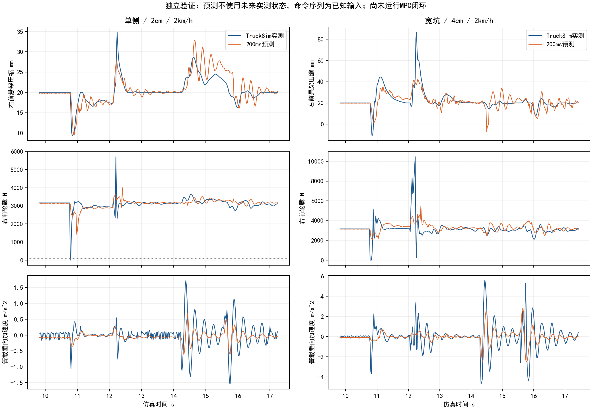

# 浅坑 MPC 路线首轮模型验证

日期：2026-10-13。对象：同一 `tuned_ii_20261005`，单侧 FR→RR、宽坑前轴两轮→后轴两轮。用户已批准先验证模型/MPC路线，允许先 1–3 km/h、已知坑形，能力限制与专家一对齐。

## 结论

**模型提取与局部建模可行；当前统一线性预测器未通过过坑轮载/接触验证，不能据此启用可靠的悬架—转矩联合 MPC。** 这不是“MPC不可行”的证明，也不是专家二已经实现或通过安全验收。本轮完成的是模型前置门控：原生模型取得、局部响应核对、独立工况多步预测、预瞄误差诊断和小坑数值敏感性筛查。

原生物理模型在平地小幅扰动中有较好轮载预测；过坑统一 ARX 模型对部分小坑的行程/姿态有用，但会漏判失载。应继续以原生物理模型为基础，明确接地/离地/重接地模式及轮胎包络，再验证分模式或线性时变预测器。当前阶段没有运行过坑 MPC 闭环，不宣称控制改善、无触底或安全成功。

## 1. 已完成的原生试验

正式冻结矩阵见 [mpc_validation_20261013.json](../configs/shallow_press/mpc_validation_20261013.json)，对应 [采集记录](../evidence/shallow_mpc_validation_20261013/collection.json) 与 [运行索引](../evidence/shallow_mpc_validation_20261013/case_index.md)。

- **10条辨识试验**：2条近平地静止小幅多输入扰动，8条两类坑的移动扰动试验；独立随机相位/种子；悬架力和转矩各轮独立激励。近平地深度为1 μm，不当作真正过坑样本。
- **18条独立验证试验**：两类坑×2/4/6 cm×1/2/3 km/h。验证组不施加主动悬架附加力，仍有等转矩速度 PI 和直行反馈。整条运行与辨识数据分开；不是打乱相邻采样后随机分割。
- **2条步长对照**：单侧、宽坑各一条4 cm、2 km/h，积分步长0.25 ms，对照对应0.5 ms运行。
- **1条成功的原生线性化提取**：近平地静止沉降到5.001 s，取得矩阵后继续到10 s。

正式30条矩阵运行均达到完整配置时长（静止扰动30 s，其余45 s），原生无错误；18条验证和2条步长对照均完成后轴退出。这是基准通过历史，不等同安全通过或 MPC 闭环通过。各运行没有姿态保护截断。

参数保持0.8 m坑长、0.9/1.8 m横宽、0.05 m过渡、μ=0.7、坑前2 m零速起步。源车辆身份均为 `a059431c563efcb2955863f1e5c41e1082c559ce178a039ff4952280ce1ab6cc`；步长覆盖单独标识为数值试验。力/转矩/转向总命令的幅值与变化率已逐路复核，见 [verification.json](../evidence/shallow_mpc_validation_20261013/verification.json)。

能力上限仍为每角±18.2 kN及45.4 kN/s、每轮±500 N·m及1000 N·m/s、方向盘±220°及400°/s、20 ms控制周期。辨识试验只使用小幅扰动，不等于覆盖这些上限的全部工作域。本阶段使用原生理想施力通道和零时延真值；40/60/80 ms反馈时延、真实功率和执行器动态尚未完成闭环验证。

原生提取探索编号001是准备阶段路径错误；002完整运行但指令位于END之后未执行；003–006因事件/矩阵路径解析中断；007为最终成功来源。全部目录保留，前述探索不计入正式30条矩阵。已解决的路径问题没有通过覆盖旧记录掩盖。

## 2. 确实取得了原生动力学模型

成功提取结果为：

| 矩阵 | 维度 |
|---|---|
| A | 67×67 |
| B | 67×9 |
| C | 126×67 |
| D | 126×9 |

67个状态包括车身位置/姿态/速度、角速度、四轮转动、四角悬架位移和速率，以及轮胎迟滞、制动/转向等状态。9输入为四轮转矩、四角附加力、方向盘输入。矩阵全为有限数；原生文件明确标注内部SI扰动单位。A的最大特征值实部为0，包含积分模式，不能将其解释为所有状态渐近稳定。

原生矩阵保存在 [native_linearization.m](../evidence/shallow_mpc_validation_20261013/verified_analysis/native_linearization.m) 和 [解析矩阵](../evidence/shallow_mpc_validation_20261013/verified_analysis/native_linear_model.json)。它是**平地沉降工作点的局部模型**，当前没有路面扰动输入，不是可直接预测所有坑槽的完整模型。67状态也不能未经可观测性/模型约简分析全部在线使用。

用原生物理模型、精确零阶保持离散化，独立预测近平地扰动后的10 s响应，未拟合这些运行。初始扰动状态设为沉降时的零偏差，实测初始输出作为偏置；实际9路命令作为已知输入。结果如下，数字取最差角的RMSE/最大误差：

| 多正弦幅值设置 | 悬架行程RMSE / 最大误差 | 轮载RMSE / 最大误差 | 研究筛查 |
|---|---|---|---|
| 250 N | 3.74 / 6.19 mm | 30.9 / 133.0 N | 本次局部指标通过 |
| 500 N | 6.06 / 9.26 mm | 70.4 / 286.6 N | 行程RMSE未通过 |

幅值设置是激励信号的系数，实际多正弦叠加峰值较小，不是某角持续施加250/500 N。此结果支持继续使用物理模型，但不授予过坑可行性、全力域能力或执行器硬件安全资格。详情见 [model_diagnostics_verified.json](../evidence/shallow_mpc_validation_20261013/model_diagnostics_verified.json)。

## 3. 统一线性预测器的独立验证方法

建立经典尺度化、正则化MIMO ARX二阶动态模型，以22个观测特征的两步历史、9路输入、当前/未来配置地形高度作为回归项。22特征包括四角行程/速率、四轮载、roll/pitch及角速度、车速、四轮转速、簧载垂向加速度。它是快速预测候选，不等于完整物理模型或学习控制策略。

模型只使用10条辨识运行，固定正则系数 `1e-4`，在读取验证预测结果前冻结；62项回归特征为满列秩，条件数约1951，动态谱半径0.99699。满秩与谱半径小于1只排除部分数值病态/自由发散问题，不保证接触预测准确。

预测时间为20/100/200/400 ms。每个起点只初始化两步历史，整个预测窗内不从实测状态重置。记录状态是在新命令施加前，控制输入对应随后20 ms区间，避免一个采样时刻的因果错位；mm/deg/rpm/km/h/g均明确转换到SI。

**输入序列是事后已知的实际命令，用于验证植物预测能力，不是已经在线求解的 MPC 命令。** 正式预测的路面来自冻结空间地图及起点轮位、当前速度的恒速推进，不使用未来实测轮位或原生未来 `Zgnd`。这种安排对动力学预测相对有利，预测仍失败就不能声称已验证在线控制。

误差窗口覆盖前后轴及退出附近，另对距坑沿0.3 m以内的事件节点单独筛查。预先定义的研究门槛为：行程RMSE≤5 mm、最大误差≤15 mm；姿态RMSE≤0.5°、最大≤1.5°；轮载RMSE≤250 N、最大≤750 N；速度RMSE≤0.05 m/s、最大≤0.15 m/s。失载按Fz<100 N且轮胎压缩≤0.1 mm；此时预测载荷≥500 N算误判支撑，资格要求没有这种误判。门槛是本项目研究标准，不是行业安全标准。

整窗和坑沿门槛、完整后轴退出共同参与工况资格。独立审查发现原实现尚未将坑沿单独RMSE与后轴退出接入资格、且NPZ写入会在重复分析时覆盖；现已修复并加入回归测试。原分析保留，正式结论使用 [verified_analysis/prediction_summary.json](../evidence/shallow_mpc_validation_20261013/verified_analysis/prediction_summary.json)。这些修正没有重新拟合模型、改变门槛或使失败样本转为通过。

## 4. 过坑预测结果：轮载/接触未通过

18条独立验证在所有4个时间尺度上均未通过轮载与接触资格。以下为200 ms、最差角误差；这是**预测误差**，不是实际车辆的行程或轮载峰值。

| 代表条件 | 行程RMSE | 轮载RMSE | 轮载最大误差 | 误判支撑采样数 |
|---|---:|---:|---:|---:|
| 单侧2 cm、2 km/h | 2.12 mm | 382.0 N | 3088.6 N | 3 |
| 单侧4 cm、2 km/h | 5.11 mm | 717.0 N | 4674.8 N | 6 |
| 单侧6 cm、2 km/h | 7.57 mm | 1102.3 N | 11818.7 N | 13 |
| 宽坑2 cm、2 km/h | 2.68 mm | 459.6 N | 3402.1 N | 2 |
| 宽坑4 cm、2 km/h | 7.02 mm | 919.5 N | 7059.5 N | 17 |
| 宽坑6 cm、2 km/h | 12.30 mm | 2361.2 N | 12822.9 N | 56 |

采样数按逐轮20 ms预测目标节点相加，不是独立事故次数或整车持续时间。2 cm部分条件的行程、姿态较好，仍会在实际失载时预测有支撑；这对按轮载分配转矩很危险，不能用其他指标通过补偿。完整18条件见 [prediction_table.md](../evidence/shallow_mpc_validation_20261013/prediction_table.md)。

相较“未来输出始终等于当前输出”的持续值基准，模型在15/18条件中降低了最差角轮载RMSE，但所有条件仍超门槛。改善平均误差并不等于模型可用于安全约束。



## 5. 不是仅靠更准确的位置预瞄就能解决

额外进行事后理想预瞄诊断：用未来实测轮位，在同一配置地图上获取高度序列，仅用来区分恒速位置预测误差与模型结构误差。这条序列有未来信息，**不参与模型拟合、正式资格或在线控制**。

200 ms下，即使使用这条理想地形序列，18条件仍全部未通过联合指标。单侧2 cm、2 km/h的轮载RMSE从382.0降至378.8 N、最大误差仍约3088.4 N。预瞄完善有必要，但不能单独解决当前问题。

结果提示需要进一步处理：实际轮胎接触包络与轮心地形高度的差异；单边接触/失载/重接地；轮胎迟滞和陡沿作用；止挡及悬架非线性。当前诊断不足以将误差全部归因于其中某一个因素。

## 6. 小坑数值敏感性仍需处理

相同4 cm、2 km/h、等转矩/被动悬架/直行反馈，从0.5 ms改到0.25 ms，保持1 ms原生日志和20 ms控制更新：

| 条件 | 最差角轮载峰值变化 | 最差角压缩峰值变化 | 10 ms垂向加速度峰值变化 |
|---|---:|---:|---:|
| 单侧 | 5.54% | 5.66 mm | 0.033% |
| 宽坑 | 10.03% | 3.03 mm | 29.82% |

两组均未通过本轮筛查（轮载/加速度变化≤5%、压缩峰值变化≤2 mm、姿态峰值变化≤0.5°）。只有两档步长，不能称为收敛研究完成；控制首tick/日志首样本相位也相差0.25 ms，不能把全部差异归为积分器误差。这些是原车轮胎/止挡与控制耦合的结果，本轮没有新增底盘罚接触力。

因此连首批小坑也需进一步确认接触处理、抽样相位及更细步长，不能简单沿用旧深宽坑的数值峰值来优化控制。

## 7. 下一阶段的 MPC 路线

1. **保留 MPC 路线，改用明确的物理接触结构。** 原生矩阵是已验证的起点；四接地时建立路面扰动接口及可观测的垂向/姿态/轮端简化模型，不直接把67个内部状态都假定可测。
2. **增加分模式预测。** 单边接触、轮胎离地、重接地和止挡进入须有专门模型/判据，预测法向力不能成为负拉力。原生Fz坐标和当地路面法向亦需核对，才能约束摩擦锥。
3. **先验证新的预测模型，再启用控制求解。** 使用新的独立验证运行；不能修改权重/结构后反复把同18条数据当作“未见数据”。保持误判支撑和坑沿误差门控。
4. **补齐数值可信范围。** 采用固定控制/记录相位的步长对照，核查轮胎接触包络。优先2 cm低速域，逐步扩展；不能通过放松模型误差门槛、调整车辆参数或将坑沿变缓，宣布原场景合格。
5. **模型合格后才比较闭环贡献。** 同能力、同速度对照悬架MPC、转矩协调及完整控制；再加入40/60/80 ms时延、执行器动态和几何误差。底盘实体几何未知仍须标未评估。

本轮结论是 `MODEL_EXTRACTION_FEASIBLE / CURRENT_LINEAR_PIT_PREDICTOR_NOT_QUALIFIED / MPC_CLOSED_LOOP_NOT_RELEASED`。`ShallowPressStrategy`保持NOT_IMPLEMENTED，两个专家和公共车辆生成规则未被本轮改写。

## 8. 代码与复查

新代码位于 `strategies/shallow_press/prediction.py`、`identification.py`、`validation.py`，与专家一无相互导入。命令为：

```powershell
# 独立新运行，编号必须不存在；不会覆盖旧结果
python scripts/run_shallow_mpc_validation.py --case right_track --depth-m .02 --speed-kph 2 --run-id my_mpc_model_trial --duration-s 45
# 正式原矩阵首次采集入口；已有目录时拒绝重复覆盖
python scripts/run_shallow_mpc_matrix.py
# 在独立新目录复算已冻结模型与矩阵，源数据保持不变
python scripts/analyze_shallow_mpc_validation.py --output-dir tmp/my_mpc_prediction_review
```

分析不调用原生DLL；采集每次独立进程。原生历史均保留，可以通过现有TruckSim播放接口按运行索引打开；本轮未导出视频。程序测试覆盖因果时序、SI单位、独立实例、自由预测、输入限制、完整来源、坑沿门槛、误判支撑、重复输出保护。单元/回归测试通过不等同MPC实车验证。

最终全套529项测试通过（10条既有第三方弃用警告）；独立审查确认原生数据、单位/时序与结论范围一致，所发现的3项门控/证据保护问题均已修复。原生运行及预测资格的验证与程序测试分别记录。
