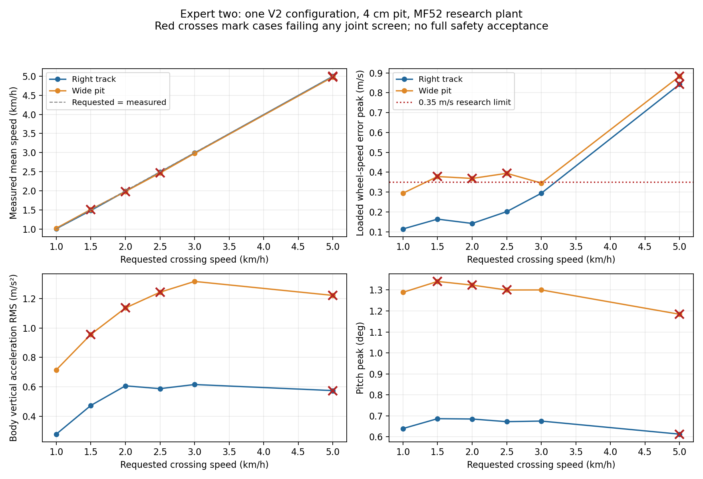

# 专家二多速度调优与悬架平顺性（2026-10-24）

本轮采用用户选定的已知坑形预瞄前馈＋经典反馈，MF52为用户批准的专家二研究基线；原内部模型及专家一保留。多速度最终候选为`configs/shallow_press/preview_multispeed_v2_20261024.json`，初次多速度配置和全部失败对照保留，不能混合不同配置的通过点。

## 控制流程与下压时机

1. 静止沉降3 s，记录车高、姿态、悬架位置和轮载；候选配置再用2 s平滑姿态参考调平。随后按0.16 m/s²斜坡起步，车身速度PI跟踪显式给定的蠕行速度。3/5 km/h试验在坑前12 m起步，报告真实过坑速度。
2. 用每个轮的实时位置、车速和已知坑形，预测未来轮心支撑高度。单侧依次FR→RR，宽坑依次前轴→后轴。轮心支撑按有限轮胎半径计算，再经过有界二阶整形；不改变物理坑形。
3. **该轮将要下落前开始下压跟随**：预瞄高度变负、下降速度出现时，位移与速度前馈给出伸展/支撑附加力。当前模型正FS降低Jnc、支撑车身，不能把下压轮胎解释为压低车身。3 km/h预瞄0.35 s，对应约0.29 m；5 km/h预瞄0.15 s，对应约0.21 m。后轮根据自身位置单独触发，不与前轮同时施加固定脉冲。
4. 过坑时持续叠加升沉、侧倾、俯仰和轮端速度反馈。用重心及四轮几何把所需垂向力与两个姿态力矩分配四角；姿态阻尼与升沉阻尼分开调节。路面前馈为`−k*r−c*rdot−m*rddot`，并非全程最大下压力。将出坑时参考上升，速度前馈改变方向，抑制轮端上冲和车身二次振动。
5. 车速PI与预瞄爬沿阻力补偿生成总转矩，再按可用接触轮载/附着与横摆反馈分配。爬沿补偿只在车速不足时启用；失载减扭、重接地渐进恢复名义驱动，防滑修正不被恢复坡道屏蔽。2 ms轮速环使用轮周速度相对车身局部速度的差及滤波微分；20 ms车身环与原生积分步长独立。转向反馈持续抑制横移与横摆。
6. 后轴完全驶出并增加停车余量后，降速、停车驻留。原生完整跑到40 s；没有姿态越限提前截断。

悬架工作力限从3500提高到6000 N，硬限仍±18200 N、45400 N/s。转矩基线仍±500 Nm、1000 Nm/s，方向盘仍±220°、400°/s。工作力限和2 ms电机响应为研究设置，不是实测硬件额定规格。参考整形自然频率参数8/20的单位为s⁻¹，不能写成8/20 Hz。

## 验证规则

坑纵向0.8 m、坑沿过渡0.05 m、单侧横宽0.9 m／宽坑1.8 m，名义μ0.7；车身观测延迟40 ms、电机2 ms。统一V2配置测试两类4 cm坑的1/2/3/5 km/h、两类2 cm坑的3/5 km/h、两类6 cm坑的1/3 km/h，并包含重复、80 ms车身延迟、积分0.5→0.25 ms、仅转矩/速度PI对照和1.5/2.5 km/h中间点。所有病例先冻结配置与完整依赖源码SHA，再以两个独立原生进程调度。源与输出不覆盖。

研究筛查同时核查实际速度（均速误差<max(15%,0.15 km/h)）、完整前后轮通过和停车、姿态/轨迹、行程、接触保持、轮载峰值、冲击、输入幅值/变化率及出坑停顿。轮周速度误差门槛0.35 m/s、最大轮载/静载门槛2.5等保持不变。1 ms全量数据与代码/模型/配置哈希校验后汇总。原生进程成功不代表筛查通过。

## 独立转矩能力扫描

用户已批准更快响应扫描，保持±500 Nm幅值、悬架与转向能力基线不变。对初次多速度配置的宽坑4 cm／5 km/h，分别测试5000、10000、20000 Nm/s，名义对照仍1000 Nm/s。10000 Nm/s时轮速误差约0.253 m/s，明显低于基线约0.855 m/s，但最大轮载/静载约2.584，仍超过2.5；20000没有继续显著改善。5000时误差约0.468、轮载比约2.556，二者均未通过。

这说明该工况对转矩响应很敏感，**增加响应能力仍不足以独立解决联合约束**，也不证明已知真实电机能实现这些响应。基线criteria保留，诊断另列diagnostic_criteria；所有扫描固定`CAPABILITY_DIAGNOSTIC_ONLY`、`simulation_pass=false`、`acceptance_pass=false`，未采纳为新硬件基线。见[扫描工况索引](../evidence/shallow_torque_capability_20261024/case_index.md)。

## 数据、复现与范围

初次统一多速度26项：13项通过；宽坑4 cm的2/3 km/h仍有微小轮速超限，单纯提高轮速比例增益、预瞄阻尼或参考变化速度没有普遍改善。降低姿态增益后出现新的3 km/h通过点，最终V2独立冻结复测，不能把开发点当作整段速度鲁棒性。初次矩阵见[索引](../evidence/shallow_multispeed_20261024/case_index.md)，原22项低速矩阵见[初批报告](SHALLOW_PREVIEW_FEEDBACK_20261024.md)。

V2结果以[工况索引](../evidence/shallow_multispeed_v2_20261024/case_index.md)及`verified_analysis.json`为准。原生历史保留在`runs/shallow_press/<case>/<run_id>/model/output/`，可直接用TruckSim播放，无需保存视频。

```powershell
$env:PYTHONPATH='src'
python scripts/run_shallow_preview_matrix.py --plan evidence/shallow_multispeed_v2_20261024/frozen_plan.json --workers 2 --resume
python scripts/analyze_shallow_preview.py --evidence evidence/shallow_multispeed_v2_20261024
python scripts/open_run_visualizer.py runs/shallow_press/right_track/preview_multispeed_v2_validation_right_track_d04_v30_20261024_001
```

复现需要当前版本的原始字节源码；若本地换行或代码修改导致计划SHA漂移，应从该运行`source/`快照恢复到独立工作目录后复现，不得更新旧计划SHA后冒充同一验证。

这些是参数化仿真筛查，不是实车安全验收。MF52在5 cm陡坑沿的接触适用性、真实底盘/桥壳几何与接触反力、悬架实体行程/功率/带宽尚未完成标定。底盘10/15/20 cm净空是显式假定矩形平面分析，不构成“不会触底”的证明。所有acceptance_pass保持false，未验证速度/深度及测量误差不自动放行。

## 最终V2结果

30项完整运行均到40 s，18项通过研究联合筛查。以下同一V2配置，未通过项不计入能力范围。

|坑类|深度cm|目标km/h|实际均速km/h|筛查|轮速误差m/s|未通过项|
|---|---:|---:|---:|---|---:|---|
|单侧|4|1|1.005|通过|0.114|—|
|单侧|4|2|1.985|通过|0.142|—|
|单侧|4|3|2.988|通过|0.294|—|
|单侧|4|5|4.998|未通过|0.843|loaded_wheel_speed_error|
|单侧|2|3|2.996|通过|0.069|—|
|单侧|2|5|5.010|通过|0.087|—|
|单侧|6|1|1.006|通过|0.241|—|
|单侧|6|3|2.974|未通过|0.770|loaded_wheel_speed_error, wheel_load_peak|
|宽坑|4|1|1.020|通过|0.294|—|
|宽坑|4|2|1.981|未通过|0.369|loaded_wheel_speed_error|
|宽坑|4|3|2.979|通过|0.345|—|
|宽坑|4|5|4.981|未通过|0.883|loaded_wheel_speed_error|
|宽坑|2|3|2.994|通过|0.121|—|
|宽坑|2|5|5.006|通过|0.129|—|
|宽坑|6|1|1.043|未通过|0.351|loaded_wheel_speed_error, wheel_load_peak|
|宽坑|6|3|2.838|未通过|3.945|loaded_wheel_speed_error, contact_retention, wheel_load_peak|
|单侧|4|1.5|1.484|通过|0.164|—|
|单侧|4|2.5|2.485|通过|0.202|—|
|宽坑|4|1.5|1.511|未通过|0.378|loaded_wheel_speed_error|
|宽坑|4|2.5|2.465|未通过|0.394|loaded_wheel_speed_error|

单侧4 cm的1、1.5、2、2.5、3 km/h离散点通过；宽坑4 cm只有1与3 km/h通过，1.5、2、2.5 km/h均未通过轮速门槛。因此**不能宣布1–3 km/h连续范围鲁棒**。宽坑3 km/h轮速误差0.3454 m/s，相对门槛仅余0.0046 m/s；积分减半为0.3465，重复为0.3454，但80 ms车身延迟时为0.4731且轮载超限。该通过点的裕量较薄。

两类2 cm坑3/5 km/h均通过；两类4 cm坑5 km/h仍有轮速误差约0.843/0.883 m/s。单侧6 cm的1 km/h通过，3 km/h未通过轮速/轮载；宽坑6 cm的1/3 km/h均未通过，3 km/h还有接触保持问题。尚未验证更深坑或10 km/h控制，自动降速不等于已验证所有降速后的速度点。

全部运行通过完整前后轮/停车、实际均速、5°姿态、路径、软件行程及九路输入幅值/变化率检查。两类4 cm／3 km/h的出坑低速停留均为0。全矩阵最长低于20%目标速度的出坑停留为0.314 s，出现在未通过的宽坑6 cm／1 km/h，不能笼统说所有工况完全没有短时减速。



图中红叉代表该工况有任一联合判据未通过，不代表所在纵轴指标本身超限；连线仅作离散数据的视觉引导，未测速度不作插值通过。

## 悬架控制的实际贡献

相同车速规划、MF52、转矩/防滑/转向算法，只将悬架力置零作匹配对照。在4 cm／3 km/h：

|指标|单侧仅转矩|单侧完整控制|宽坑仅转矩|宽坑完整控制|
|---|---:|---:|---:|---:|
|垂向RMS m/s²|0.666|0.615|1.328|1.317|
|10ms垂向峰值 m/s²|2.752|2.395|4.934|4.747|
|侧倾峰值°|1.197|1.036|1.112|0.923|
|俯仰峰值°|0.936|0.675|1.929|1.300|

单侧垂向RMS下降约7.6%、侧倾13.4%、俯仰27.9%；宽坑分别下降约0.9%、17.0%、32.6%。**姿态改善明确，宽坑垂向RMS改善仍小**。仅转矩宽坑3 km/h轮速误差0.3650未通过，完整控制为0.3454通过。不能把较大姿态收益解释为所有平顺性指标均显著改善。

初次多速度配置在5 km/h下，相比此前慢参考的D20版本，宽坑垂向RMS约1.817→1.205 m/s²、10 ms峰值6.331→4.881、俯仰1.823°→1.097°；但轮速误差仍超限。这是组合悬架增强的开发证据，不是该5 km/h工况整体通过，也不是最终V2单因素收益。见`evidence/shallow_multispeed_20261024/body_improvement.json`。

## 后续优先问题

优先设计轮胎进坑/重接触期间的悬架加载速率与逐轮转矩预瞄配合，降低速度敏感的轮速误差；不继续盲目增大姿态/轮速增益。随后在同一参数下验证更密速度点、坑形/附着扰动和反馈时延。更快转矩诊断没有通过全部联合判据，原能力基线继续保留。MF52接触动态及实际执行器/底盘几何标定是扩大可靠范围的重要前提。

## 版本与检查

源/模型/输入与原生历史已逐项校验，566项Python测试通过（10项第三方弃用警告），专家一控制/参数目录相对备份版本差异为空，抬轮入口dry-run通过。本轮没有额外重跑专家一原生完整循环。中间48份调参配置已校验归档；原生成功/失败历史均保留，未保存视频。

累计224条预瞄控制开发运行索引保存在`evidence/shallow_multispeed_v2_20261024/development_index.json`，包含失败与模型对照，不作为统一资格统计。初批历史索引保持原样。
