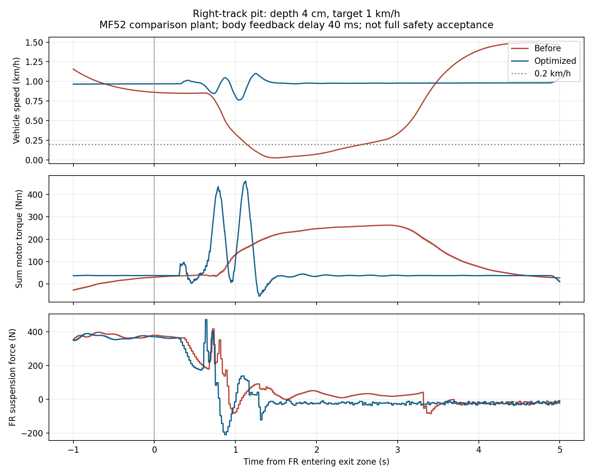

# 专家二预瞄前馈与反馈：2026-10-24研究记录

## 当前结论

专家二已实现独立的静止沉降、起步、预瞄蠕行、逐轮跟随、出坑牵引补偿、后轴退出与停车保持。完整控制为经典方法，不依赖学习或MPC。原抬轮算法与配置未修改。

本轮首先解决用户视频中指出的前轮出坑卡顿。相同MF52对照车型、4 cm单侧坑、0.8 m纵向长度、5 cm坑沿过渡、目标1 km/h、车身反馈延迟40 ms：

|指标|原视频|出坑优化版本|
|---|---:|---:|
|前轮出坑最低车速 km/h|0.0262|0.7641|
|前轮出坑低于0.2 km/h最长持续 s|1.443|0|
|后轮出坑最低车速 km/h|0.2308|0.8906|
|过坑垂向加速度RMS m/s²|0.3989|0.3047|
|10 ms平均垂向加速度峰值 m/s²|2.9152|1.7351|

改动包含更强的车身速度反馈、仅在速度不足时启用的正向爬沿转矩补偿，以及有界的15 cm接触位置不确定区间。后者是软件研究假设，不是实测轮胎接地长度。原视频在轮心几何已接近平地时仍有爬沿阻力，而速度反馈及转矩斜率限制使牵引恢复偏晚。加速过量时补偿关闭，进坑制动仍由速度反馈负责。



## 固定参数验证与消融

固定配置为`configs/shallow_press/preview_feedback_20261024.json`。22项计划在派发前冻结，所有运行代码快照一致，完整跑到40 s；无姿态保护提前结束。包括两类2/4/6 cm坑在1/2 km/h下的12项、4 cm重复、0.25 ms积分步长、80 ms车身时延、仅转矩控制及无主动悬架/防滑的对照。电机反馈延迟2 ms；电机环2 ms、车身环20 ms，积分细化不改变控制周期。

22项中18项通过参数化研究筛查。12项核心完整控制中9项通过：

- 单侧2、4、6 cm在1、2 km/h均通过。
- 宽坑2 cm在1、2 km/h通过，4 cm在1 km/h通过。
- 宽坑4 cm／2 km/h、6 cm／1和2 km/h未通过轮速误差门槛。其轮周速度相对车身局部速度误差峰值分别约0.997、0.443和1.667 m/s；原生Kappa也出现较大值，不能仅解释为视频外观问题。
- 两类4 cm重复运行、积分减半及80 ms车身时延对照均通过。它们是离散点验证，不构成连续时延或速度区间的保证。
- 宽坑4 cm／1 km/h无主动悬架及防滑对照未通过轮速门槛，完整控制和仅转矩控制通过。

悬架贡献尚不充分：在单侧4 cm／1 km/h，完整控制与仅转矩控制的垂向RMS分别为0.3047和0.2847 m/s²；宽坑分别为0.7578和0.6745 m/s²。完整控制减小部分俯仰峰值，但当前不能声称悬架改善了所有平顺性指标。增大地面阻尼反馈可降低宽坑冲击和轮载峰值，却会放大轮速误差；减小它则增加轮载峰值。未通过联合门槛的候选没有发布为默认参数。

额外试验表明：6 cm单侧降到0.5 km/h可通过；同速度宽坑有回退，降低目标速度并非充分条件。减速度超前预测、过强轮速反馈与预瞄时域扩展均未单独解决宽坑问题，失败运行完整保留。下一优化重点是进坑重接触、牵引/制动分配与悬架阻尼的联合约束，而非继续单纯增加出坑转矩。

完整工况、失败指标和视频来源见[工况索引](../evidence/shallow_preview_feedback_20261024/case_index.md)，逐项指标与哈希见`verified_analysis.json`，开发试验索引见`development_index.json`。原视频缺少后续版本才引入的便携模型身份文件，比较脚本显式标为历史来源并校验其原模型、日志和源码哈希，没有改写历史结果。

## 轮胎模型与能力边界

原车型内部PAC52点接触在短陡坑沿出现显著轮速异常。已核查程序原生单位：历史`VLOW_*=0.2`实际为km/h；原变量名中的m/s不准确。本轮只修正共享注释，未改变专家一车型参数或生成规则。

独立MF52版本使用原轮胎主要静态系数、原车轮/轮胎转动惯量和安装位置，调用已安装TNO外部模型。轮胎元数据、垂向刚度、低速正则化和接触动态仍有显式研究假设，不能证明与实车或原内部模型等价。22项验证运行发生在用户采纳之前，清单中的`adopted=False`保留原样。用户已批准将其作为专家二后续研究基线；后续采纳身份应另行记录，不能追改旧清单。

求解过程已释放继承工况中恒定的1 MPa制动，只改专家二隔离工况的程序参数；匹配对照使用同样设置。执行器软件上限与专家一对齐：悬架±18200 N、45400 N/s，转矩±500 Nm、1000 Nm/s，方向盘±220°、400°/s。当前工作力限3500 N可替换，不代表硬件额定值。

`SIMULATION_PASS`只表示固定假设下通过研究筛查。真实底盘几何、实体悬架行程/功率/带宽和完整轮胎切向滑移尚未验收；底盘净空仅是假定矩形包络的10/15/20 cm参数分析，无真实接触反力，不能用悬架行程替代底盘触地。当前未发布完整`PASS`或10 cm策略切换边界，也未证明8–20 cm、3–10 km/h或测量误差下的安全性。

## 复现与开发效率

```powershell
$env:PYTHONPATH='src'
python scripts/run_shallow_preview_matrix.py --plan evidence/shallow_preview_feedback_20261024/frozen_plan.json --workers 2 --resume
python scripts/analyze_shallow_preview.py --evidence evidence/shallow_preview_feedback_20261024 --before-run runs/shallow_press/right_track/preview_slip_mf52_right_d4_20261024_001 --after-run runs/shallow_press/right_track/preview_frozen_validation_right_track_d04_v10_20261024_001
python scripts/open_run_visualizer.py runs/shallow_press/right_track/preview_frozen_validation_right_track_d04_v10_20261024_001
```

矩阵调度两个独立原生进程；配置/代码漂移、重复目录、不匹配的续跑及被编辑的原生日志均拒绝。逐项读取研究判据，不能把进程返回0当作工况通过。分析检查原生日志、模型、生成资源、代码快照、结果与输入身份哈希后再汇总。新增算法版本必须另建冻结计划和运行编号，旧计划因源码漂移拒绝新派发属于正常保护。

MPC源码、脚本、配置、测试及证据已转入[可恢复归档](../archive/mpc_20261013/README.md)，14份中间调参配置和无效观测器原型进入[开发归档](../archive/preview_development_20261024/README.md)。历史原生运行、专家一模型、增益、显示和五相机功能保留。

首次独立代码审查发现的接触/轮载门槛缺失、生成资源哈希陈旧、结果缺少对照模型身份均已修复并有回归测试。最新复审请求受工具配额限制未完成；最新改动由主任务逐项核查和原生矩阵验证，未声称获得第二次独立审查通过。
